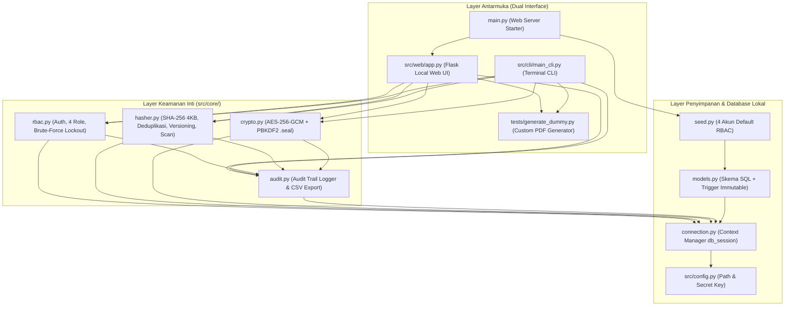
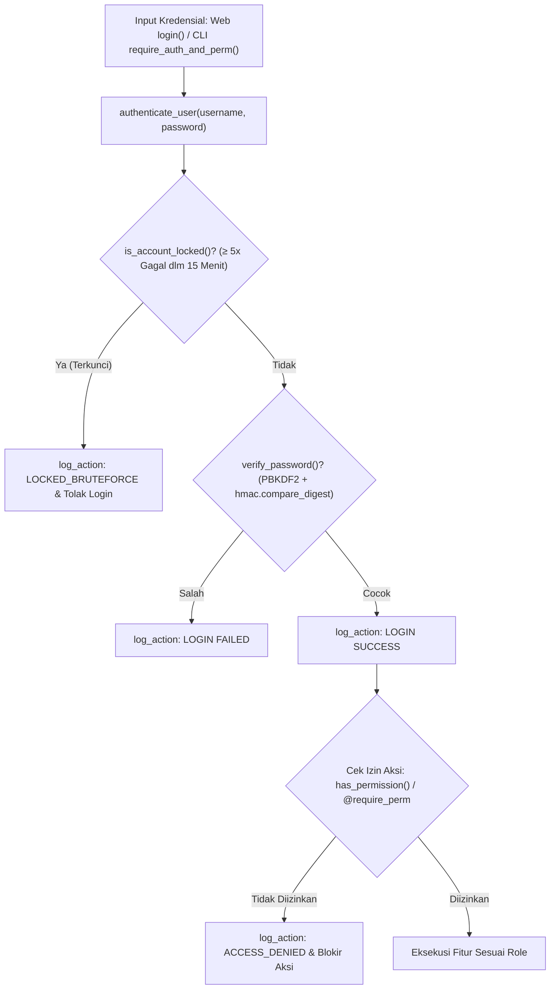
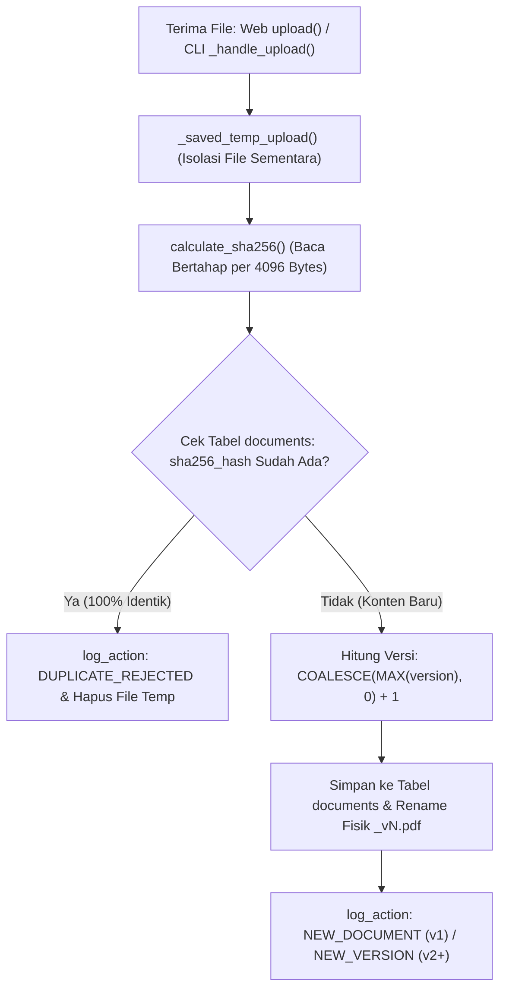
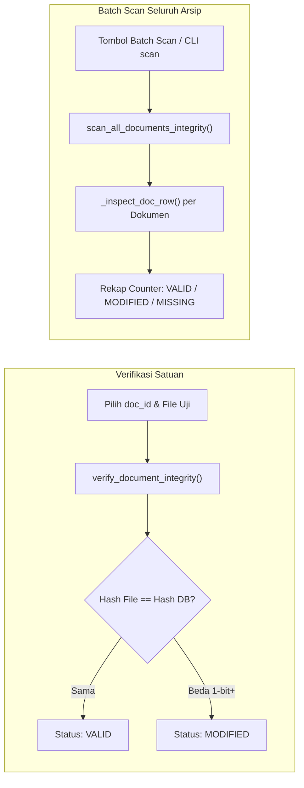
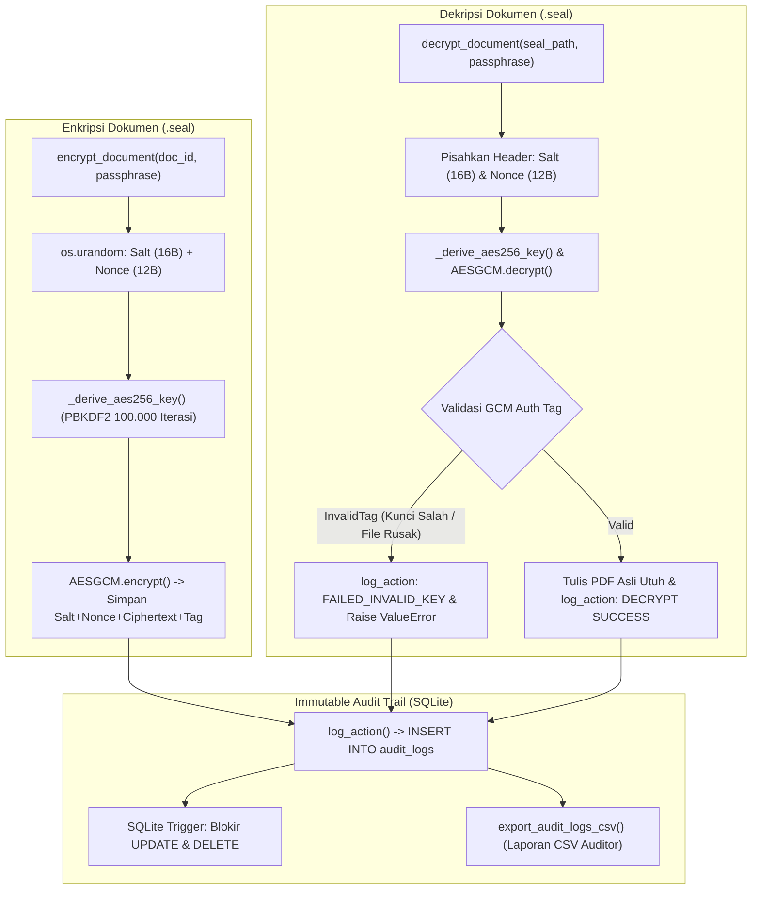

# Flowchart Interaktif Arsitektur & Kode DocSeal

> [!TIP]
> **Klik langsung pada kotak (node) di dalam diagram Mermaid** atau pada **tautan fungsi di tabel indeks** di bawah setiap diagram untuk langsung melompat ke file dan baris kode aslinya di editor.

---

## 1. Peta Arsitektur Utama (End-to-End Overview)

| Komponen Arsitektur | Lompat ke Kode Sumber |
| :--- | :--- |
| Entry Point & Seeding Awal | [main.py](../main.py#L1-L7) · [`seed_database()`](../src/database/seed.py#L13-L27) · [`init_db()`](../src/database/models.py#L50-L53) |
| Konfigurasi & Sesi SQLite | [config.py](../src/config.py#L3-L15) · [`db_session()`](../src/database/connection.py#L17-L24) |
| Antarmuka Pengguna (Web & CLI) | [app.py](../src/web/app.py#L122-L311) · [main_cli.py](../src/cli/main_cli.py#L85-L216) · [`create_custom_pdf()`](../tests/generate_dummy.py#L26-L70) |

---

## 2. Alur Autentikasi, Proteksi Brute-Force, & Otorisasi RBAC

| Tahap Eksekusi | Lompat ke Baris Kode |
| :--- | :--- |
| Matriks 4 Role (`ROLE_PERMISSIONS`) | [`ROLE_PERMISSIONS`](../src/core/rbac.py#L8-L13) · [`has_permission()`](../src/core/rbac.py#L33-L35) |
| Hashing & Anti-Timing Attack | [`hash_password()`](../src/core/rbac.py#L18-L22) · [`verify_password()`](../src/core/rbac.py#L25-L30) |
| Deteksi Brute-Force & Login | [`is_account_locked()`](../src/core/rbac.py#L38-L57) · [`authenticate_user()`](../src/core/rbac.py#L60-L81) |
| Guard RBAC di Web & CLI | [`require_perm()`](../src/web/app.py#L32-L50) · [`require_auth_and_perm()`](../src/cli/main_cli.py#L18-L34) |
| Manajemen Akun oleh Admin | [`create_user()`](../src/core/rbac.py#L95-L137) · [`create_user_route()`](../src/web/app.py#L288-L300) |

---

## 3. Alur Upload, SHA-256 Chunking, Deduplikasi, & Auto-Versioning

| Tahap Eksekusi | Lompat ke Baris Kode |
| :--- | :--- |
| Mesin SHA-256 (4KB Chunking) | [`calculate_sha256()`](../src/core/hasher.py#L9-L19) |
| Deduplikasi & Auto-Versioning | [`register_document()`](../src/core/hasher.py#L22-L72) |
| Penanganan Upload Aman Web UI | [`_saved_temp_upload()`](../src/web/app.py#L54-L62) · [`upload()`](../src/web/app.py#L186-L206) |

---

## 4. Alur Verifikasi Integritas Satuan & Batch Integrity Scan

| Tahap Eksekusi | Lompat ke Baris Kode |
| :--- | :--- |
| Verifikasi Dokumen Satuan | [`verify_document_integrity()`](../src/core/hasher.py#L75-L103) · [`verify()`](../src/web/app.py#L211-L222) |
| Batch Scan Deteksi Disk Tampering | [`_inspect_doc_row()`](../src/core/hasher.py#L106-L123) · [`scan_all_documents_integrity()`](../src/core/hasher.py#L126-L149) |

---

## 5. Alur Enkripsi & Dekripsi AES-256-GCM (`.seal`) + Immutable Audit Log

| Tahap Eksekusi | Lompat ke Baris Kode |
| :--- | :--- |
| Derivasi Kunci PBKDF2-HMAC-SHA256 | [`_derive_aes256_key()`](../src/core/crypto.py#L19-L26) |
| Enkripsi & Unduh `.seal` | [`encrypt_document()`](../src/core/crypto.py#L29-L62) · [`encrypt_route()`](../src/web/app.py#L243-L257) · [`download_seal()`](../src/web/app.py#L305-L311) |
| Dekripsi & Verifikasi GCM Tag | [`decrypt_document()`](../src/core/crypto.py#L65-L112) · [`decrypt_route()`](../src/web/app.py#L262-L283) |
| Immutable Audit Log & CSV Export | [`log_action()`](../src/core/audit.py#L7-L19) · [`prevent_audit_log_update`](../src/database/models.py#L36-L46) · [`export_audit_logs_csv()`](../src/core/audit.py#L22-L68) |

